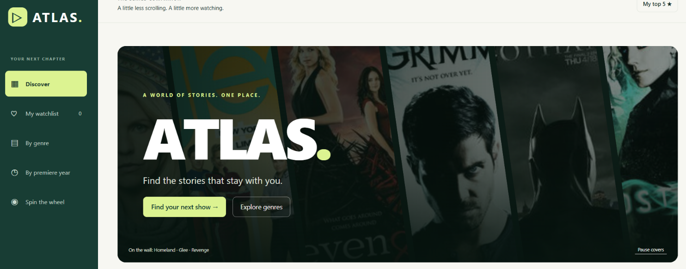
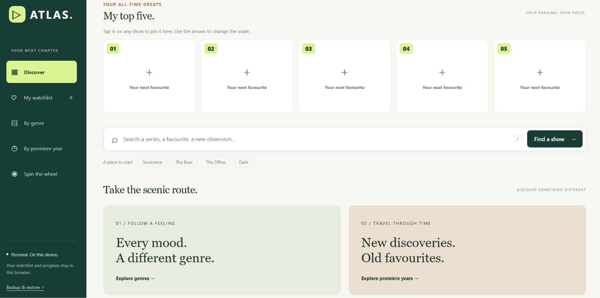
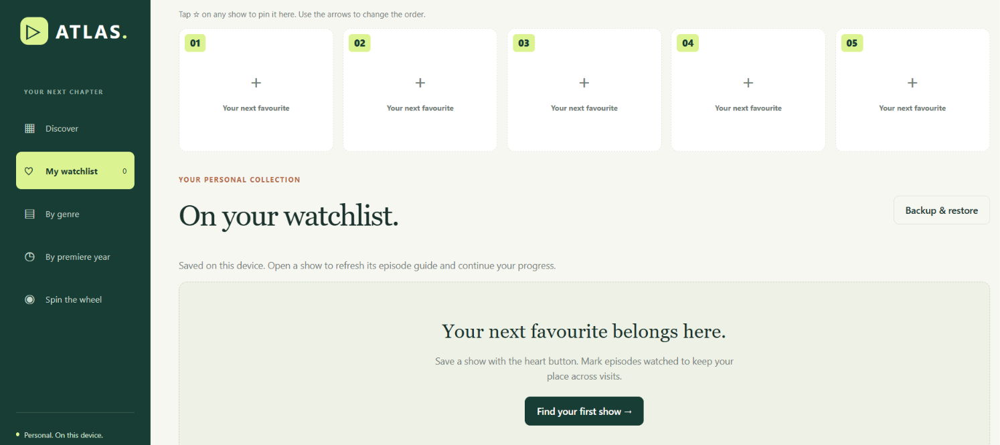
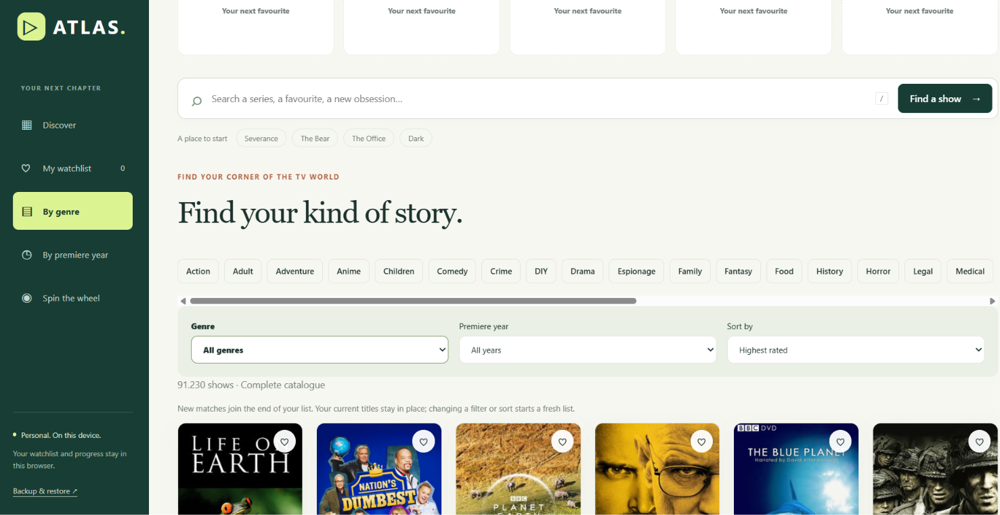
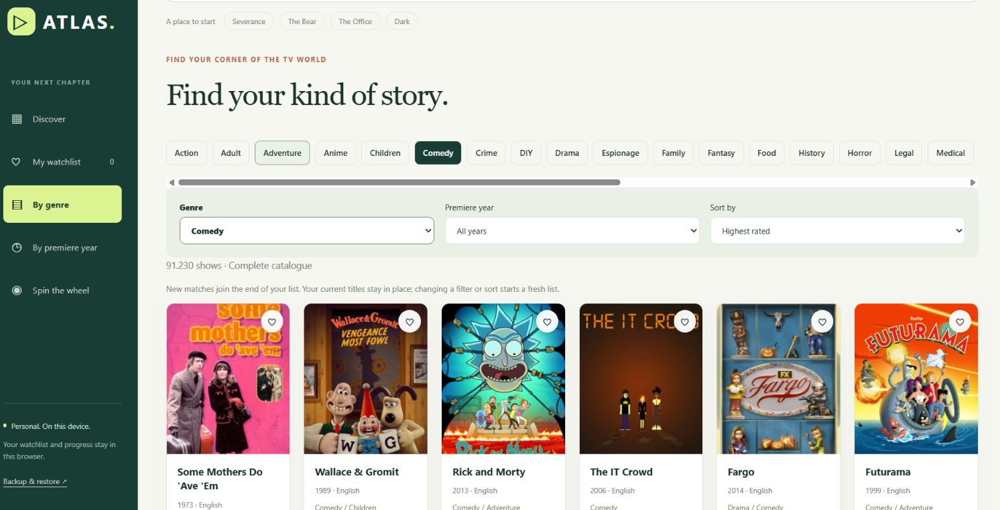
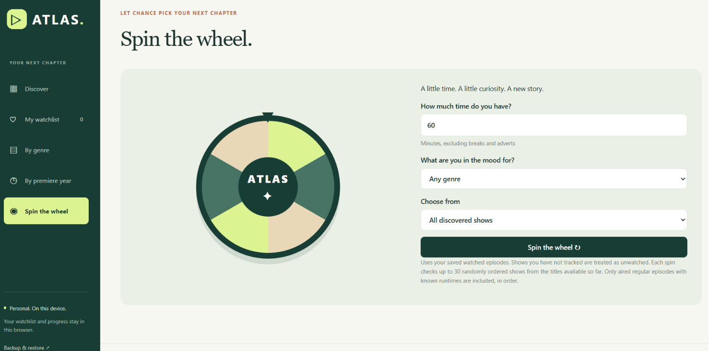
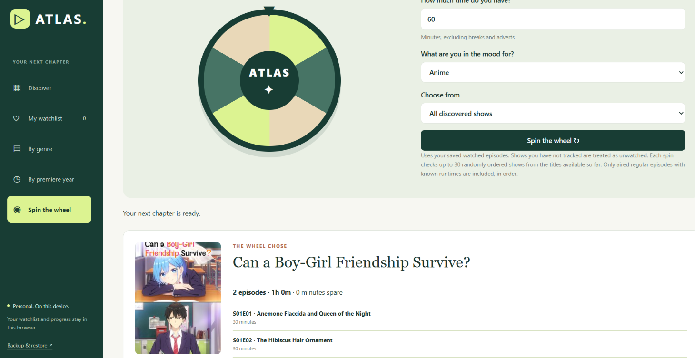

# ATLAS

**Your world of stories.**

A TV-show discovery and viewing companion built with HTML, CSS, vanilla JavaScript and the TVmaze API.

## 1. Purpose

ATLAS helps users discover television series, organise their favourites, remember their viewing progress and choose episodes that fit their available time. It turns information from an external API into an interactive application with features designed around everyday viewing decisions.

The application includes title search, browsing by genre and premiere year, a personal top-five ranking, a watchlist, episode guides, spoiler protection, progress tracking and two viewing planners: **Tonight’s plan** and **Spin the wheel**. A rotating poster wall introduces the website.

ATLAS provides information and recommendations; it does not stream video.

## 2. Data collection

Show and episode information comes from the public [TVmaze API](https://www.tvmaze.com/api). The browser sends HTTPS GET requests and receives JSON responses. JavaScript processes these responses and displays the relevant information. The project does not scrape TVmaze's HTML pages.

| Endpoint | Information retrieved |
| --- | --- |
| `/search/shows?q=TITLE` | Shows matching a title search |
| `/shows?page=N` | Catalogue records in batches of up to 250 shows |
| `/shows/ID` | Details of a particular show |
| `/shows/ID/episodes?specials=1` | A show's listed episodes, including specials |

Collected fields include titles, genres, premiere dates, summaries, ratings, poster URLs, episode numbers, air dates and runtimes. Show IDs link search results to the correct show and its episode list. Poster images load from TVmaze's image host.

The catalogue loads automatically in the background. Title search works independently, so users do not need to wait for the full catalogue. New matching records join the end of an active browsing list, keeping existing cards in place. Requests include timeout, cancellation and bounded retry handling. No API key is required.

## 3. Data persistence

ATLAS separates personal viewing information from reusable catalogue data.

| Storage | Data stored | Reason |
| --- | --- | --- |
| Browser localStorage | Watchlist show snapshots, watched episode IDs, last-known progress and ordered top-five favourites | Preserve personal choices between visits without requiring an account |
| Browser IndexedDB | A completed catalogue and its cache timestamp, retained for reuse for up to 24 hours | Reduce repeat downloads and improve subsequent visits |
| In-memory request cache | Recent successful responses, with a five-minute expiry and a bounded entry count | Avoid repeated requests within the current tab |
| Exported JSON backup | Watchlist, favourites and watched progress | Allow manual transfer or recovery of personal collections |

Only completed catalogues are cached. If persistent catalogue storage is unavailable, the app can use data in the current tab. Backup files are validated before restoring personal state. Restoring replaces the current collection after user confirmation; older version 1 backups remain supported but contain no top-five ranking.

There is no backend database, user authentication or automatic cross-device synchronisation. Personal data belongs to the current browser and website origin. Clearing browser storage can remove it.

## 4. User interaction

1. **Discover a show:** search for a title or select a genre and premiere year. Scroll through results; a three-dot indicator shows when more titles are downloading.
2. **Explore its episodes:** open a show to see its information and episode guide. Filter by season, title or viewing status, and optionally include specials. Episode summaries remain hidden until revealed.
3. **Create a personal collection:** use the heart to save a show to the watchlist, or the star to add it to the top five. Arrow controls reorder favourites.
4. **Track progress:** mark aired episodes as watched. The app updates progress and identifies the next unwatched regular episode.
5. **Plan an evening:** enter a time budget in Tonight’s plan. It proposes unwatched aired episodes in sequence, stopping when the next episode does not fit. Runtime estimates and specials are optional.
6. **Spin the wheel:** select available minutes, a genre and either discovered shows or the watchlist. The app checks randomly ordered candidate shows and suggests a fitting sequence of unwatched episodes with known runtimes.
7. **Keep a backup:** export or restore personal collections through Backup & restore.

The interface supports narrow screens, keyboard-accessible controls, and a pause button for the cover animation. Reduced-motion preferences disable automatic cover rotation and decorative animations.

### Screenshot or demonstration

The following screenshots were captured by the project author and supplied on 19 November 2026. They document visible interface states, including a genre filter and a completed time-budget recommendation. A written [feature walkthrough](docs/DEMO_SCRIPT.md) and [user guide](docs/USER_GUIDE.md) provide further instructions.



*Welcome page with the ATLAS branding and TV show poster background.*



*Discovery page with empty top-five slots, search and browsing shortcuts.*



*Empty watchlist with instructions for saving a first show.*



*Catalogue browsing with genre, premiere-year and sorting controls. The displayed catalogue count reflects this capture, not a fixed dataset size.*



*Comedy selected, with matching show cards displayed.*



*Spin the wheel form with time budget, genre and candidate-pool controls.*



*A result for a 60-minute Anime request: two 30-minute episodes of Can a Boy-Girl Friendship Survive?, with zero minutes spare.*

These captures do not independently verify persistence after a reload, every filter, episode tracking, or all recommendation edge cases. The top-five and watchlist captures show empty states.

## 5. Setup

### Requirements and configuration

- A modern browser with JavaScript enabled.
- Internet access for TVmaze requests and images.
- Python 3 for the local-server method below, or another static HTTP server.
- Node.js 20 or newer only for development checks.

The production application has no npm dependencies, API keys, environment variables or build step. Secret configuration and a configuration example file are **not applicable**, because the app uses public endpoints and browser-local storage.

### Run locally

From the project directory containing `index.html`, run:

```sh
python -m http.server 8000
```

On Windows, use `py` if `python` is unavailable; on macOS/Linux, use `python3` where appropriate. Open [http://localhost:8000](http://localhost:8000). Keep the server running while using the app; Ctrl+C stops it.

The application can also be served through GitHub Pages or another static host. The `css`, `js` and `assets` directories must retain their paths relative to `index.html`.

### Development checks

```sh
npm test
npm run check
```

These checks use Node.js and need no npm dependency installation. The prior local validation record reports **37 passing automated logic tests**, JavaScript syntax checks and static asset-reference checks. This does not establish that a particular GitHub Actions run or deployment passed.

Optional browser tests require Playwright:

```sh
npm install --no-save playwright
npx playwright install chromium
npm run test:browser
```

The workflow at `.github/workflows/tests.yml` runs the logic tests and syntax checks on pushes and pull requests. See [Testing and verification](docs/TESTING.md) for coverage and verification limits.

### Project structure

| File or directory | Responsibility |
| --- | --- |
| `index.html` | Screens, navigation and forms |
| `css/styles.css` | Layout, colours, responsive styling and animations |
| `js/app.js` | UI interactions, rendering and personal state |
| `js/api.js` | HTTP requests and request cache |
| `js/catalogue.js` | Automatic catalogue loading and persistent cache |
| `js/discovery.js` | Catalogue filtering, stable queues, ranking and backup validation |
| `js/core.js` | Episode filtering, progress and sequential planning |
| `js/spin.js` | Random candidate selection and episode recommendations |
| `assets/` | Application icon |
| `tests/` | Logic tests and optional browser tests |
| `docs/` | User guide, technical report, walkthrough and testing record |
| `.github/workflows/` | Automated repository checks |

## 6. Learning

I found this project particularly interesting because it helped me understand how APIs work in practice. Seeing a search in the interface lead to a request and then to useful information made the concept more concrete. I began to see that understanding the data an API provides creates opportunities to develop new ideas and functionalities, rather than simply reproduce the original website.

For example, episode runtimes and viewing progress made it possible to develop time-based suggestions. Spin the wheel combines existing information with a user's preferences to propose something to watch. This helped me understand the distinction between retrieving data and designing useful behaviour around it.

One challenge was the catalogue-loading experience. Initially, users had to request more titles manually. After loading became automatic, the visible results kept changing as new shows arrived. I identified this as distracting and asked for existing titles to remain in place, with new matches added at the end and a loading indicator below them. Working through this with AI assistance showed me that a feature can retrieve the correct data while still needing improvements to its user experience.

Another practical lesson came from publishing the project. The first repository upload contained the main files but omitted the supporting folders. The audit identified that the HTML depended on missing styling and JavaScript files. I corrected the upload by adding those folders while preserving their structure, and created the testing workflow directly on GitHub when dragging its folder did not work. This showed me why checking the repository's actual contents matters, even when the application works locally.

The project also introduced me to the difference between data retrieved from an external service and personal information saved in the browser. Watchlists and watched episodes need persistence to remain useful across visits. Overall, I gained experience in defining requirements, reviewing generated results and refining a solution through feedback. AI assistance supported the implementation; I do not present the code as work completed independently.

## 7. Limitations and assistance

### Limitations

- The first full catalogue download can take several minutes. Genre and year filters only cover titles loaded so far.
- The active list preserves its order as batches arrive. Sorting applies to the initial selection and incoming batches; it is not globally reapplied during loading.
- Artwork, summaries, ratings, dates and runtimes depend on TVmaze's coverage and may be missing.
- Spin the wheel checks up to 30 randomly ordered candidates from the available pool, with a 60-second deadline. It is not an exhaustive search of every show or viewing plan.
- Recommendations use locally recorded watched episodes. Viewing history not recorded in ATLAS is treated as unwatched.
- Spin the wheel excludes specials, future episodes and unknown runtimes. Tonight’s plan can use estimates only when explicitly enabled.
- There are no accounts, streaming playback or automatic cross-device synchronisation. Storage can be unavailable or cleared by browser settings.
- Automated browser testing could not run successfully in the build environment because Chromium startup was restricted. Formal visual, live-service, accessibility and cross-browser acceptance testing has not been completed.
- Author-supplied screenshots are included above as visual submission evidence; they do not replace end-to-end testing.

### Assistance and external resources

ChatGPT/Codex was used to explain concepts, generate and revise application code, develop tests, troubleshoot problems and prepare documentation. I supplied requirements, reviewed the interface and requested changes to its design and behaviour. This README's reflection was drafted with AI assistance from my feedback and the documented development process.

The [official TVmaze API documentation](https://www.tvmaze.com/api) informed the data integration. TVmaze supplies show data and artwork. The production app uses no third-party JavaScript or CSS packages; optional browser tests use Playwright, and logic tests use the Node.js standard library. No additional tutorial sources are recorded in the project documentation.

Application code is distributed under the [MIT licence](LICENSE). TVmaze data and artwork have separate attribution and licensing terms described in [ATTRIBUTION.md](ATTRIBUTION.md). Additional implementation details are available in the [technical project report](docs/PROJECT_REPORT.md).
